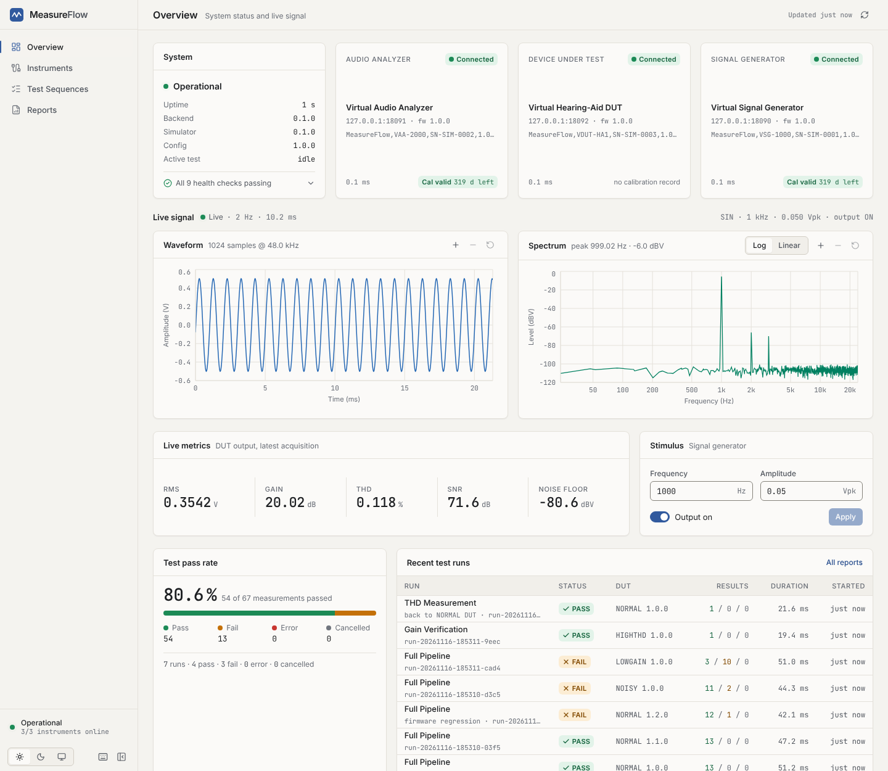
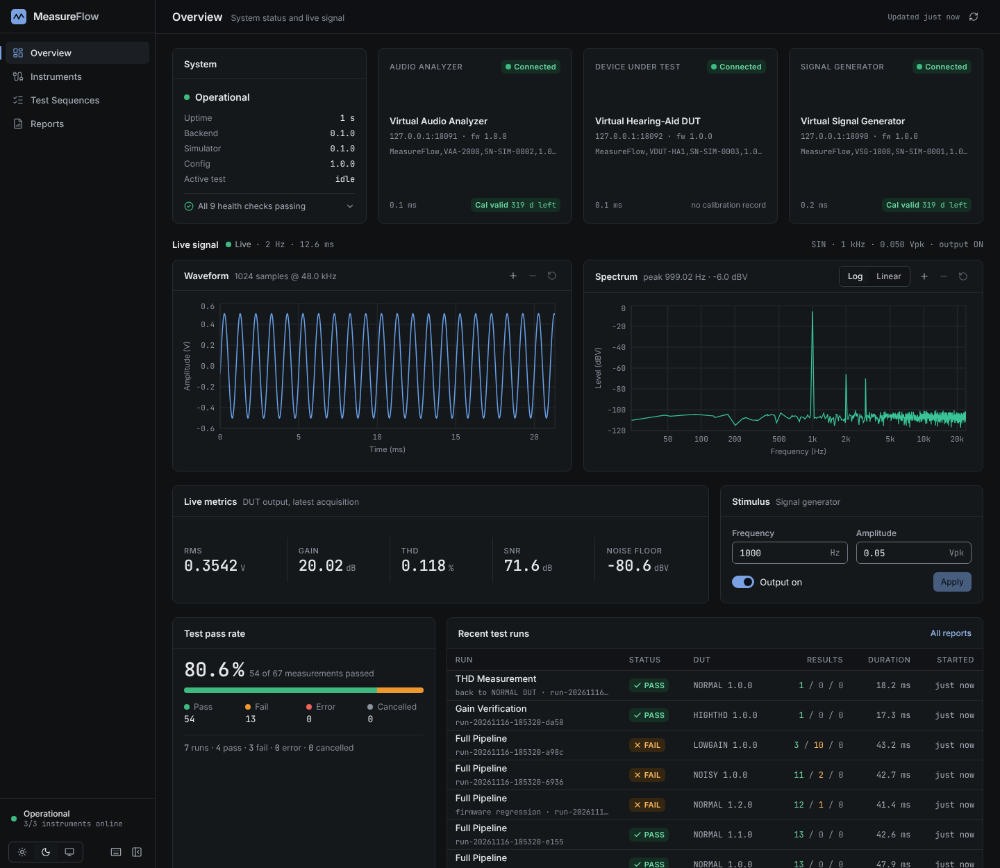
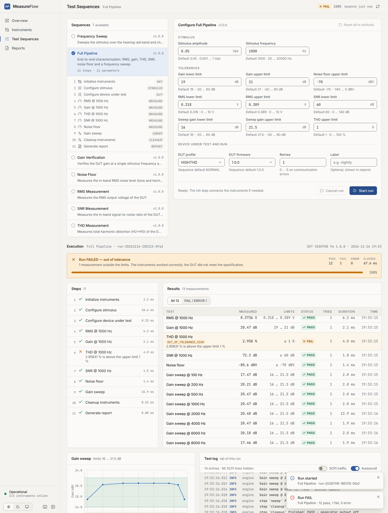
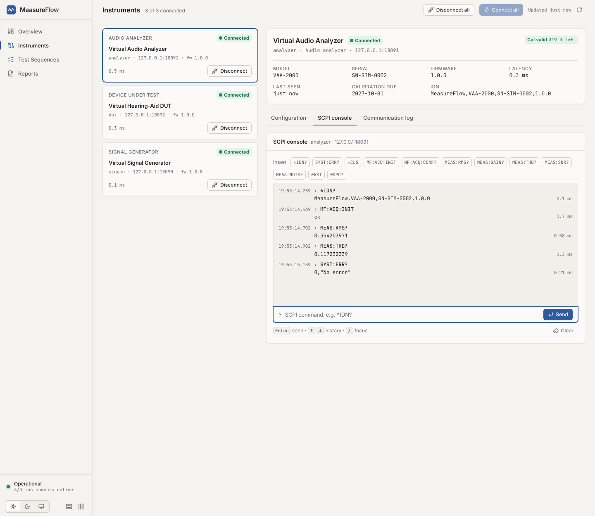
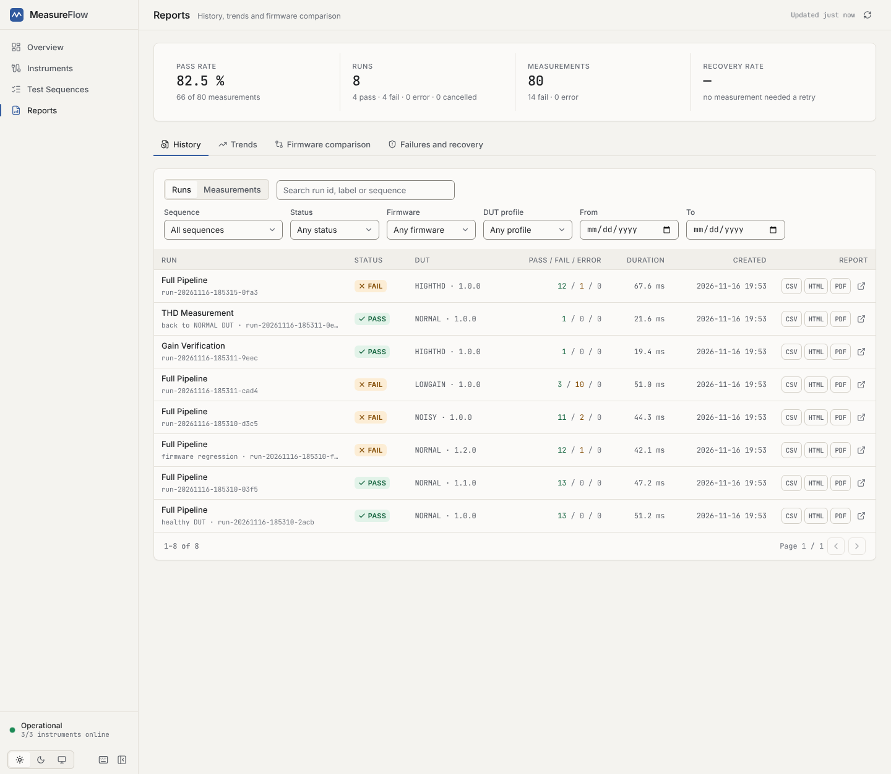
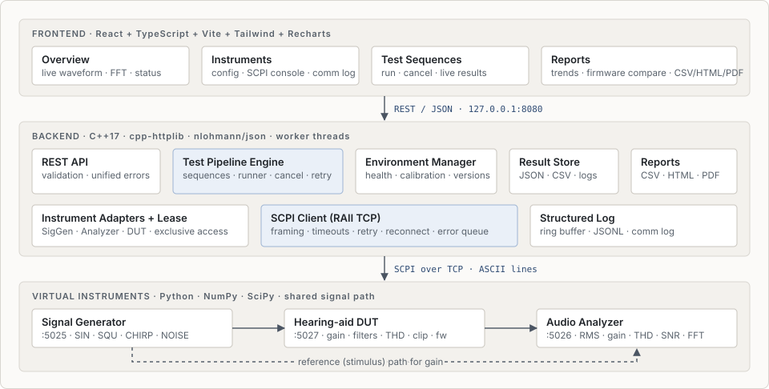

# MeasureFlow - Automated Instrument Control & Testing Platform

MeasureFlow is a small but complete test-automation platform: a web console, a C++17 REST backend with a SCPI-over-TCP
instrument layer and a test-pipeline engine, and three **simulated** instruments (signal generator, audio analyzer and a
hearing-aid device under test) that compute their measurements from really generated samples.

> **Everything in this repository was developed and tested against simulated instruments only.** No real hardware was
> used, and nothing here has been validated against a medical-device or hearing-aid standard or certified in any way.
> The SCPI dialect is *inspired by* IEEE 488.2 / SCPI conventions but is **not** compatible with commercial instruments.



| | |
|---|---|
|  |  |
|  |  |

More (all real captures of the running application, generated by `tests/e2e/specs/screenshots.spec.ts`):
[dark sequences](screenshots/sequences-dark.png) - [dark instruments](screenshots/instruments-dark.png) - [dark reports](screenshots/reports-dark.png) -
[trends](screenshots/reports-trends-light.png) - [firmware comparison](screenshots/reports-firmware-light.png) -
[empty state](screenshots/overview-empty-light.png) - [backend offline](screenshots/overview-offline-light.png).

## Contents

1. [Features](#features) - 2. [Architecture](#architecture) - 3. [Quick start](#quick-start) - 4. [SCPI reference](#scpi-reference) -
5. [REST API](#rest-api) - 6. [Test pipeline semantics](#test-pipeline-semantics) - 7. [Experiments and results](#experiments-and-results) -
8. [Testing, coverage, sanitizers](#testing-coverage-and-sanitizers) - 9. [Repository layout](#repository-layout) - 10. [Code size](#code-size) -
11. [Limitations](#limitations) - 12. [Third-party software and license](#third-party-software-and-license)

## Features

* **Four pages** (React + TypeScript + Vite + Tailwind + Recharts + Lucide): *Overview* (system health, live waveform/spectrum, live
  metrics, stimulus control, pass rate, recent runs), *Instruments* (connect/disconnect, typed settings, SCPI console, communication log),
  *Test Sequences* (pick a sequence, edit validated parameters, run, watch progress, results table, sweep chart, run log) and
  *Reports* (history, trends, firmware comparison, failure and recovery analysis, CSV/HTML/PDF downloads). Light and dark theme
  (selectable, persisted), loading / empty / error / offline states, keyboard shortcuts. Only real backend data is shown - no mock data.
* **C++17 backend** (CMake, cpp-httplib, nlohmann/json): RAII TCP sockets, a SCPI client with line framing, per-call timeouts,
  retry with backoff for idempotent commands, automatic reconnect, response-size limit and error-queue draining; an instrument registry
  with calibration records and exclusive **leases** while a test owns the instruments; a **test-pipeline engine** (init / configure / measure /
  sweep / cleanup / report steps, task statuses `PENDING / RUNNING / PASS / FAIL / ERROR / CANCELLED`, FAIL is never confused with ERROR);
  a **test environment manager** (health checks, calibration validity, writable directories); persistence as JSON / CSV / log files
  (no database); CSV, HTML and PDF reports (the PDF writer is hand-written, no PDF library).
* **Virtual instruments** (Python, numpy/scipy): a signal generator, an audio analyzer and a hearing-aid DUT (gain, polynomial
  nonlinearity, clipping, 2nd-order high-pass, 4th-order low-pass, noise; profiles `NORMAL / LOWGAIN / HIGHTHD / NOISY / CLIPPING`;
  firmware `1.0.0 / 1.1.0 / 1.2.0`, the last being a deliberate regression). They speak SCPI over real TCP sockets and can inject
  faults (timeout, disconnect, garbage, fragmented, NaN/Inf and oversize responses).
* **Seven test sequences** as JSON files in `configs/sequences/` (gain, THD, SNR, noise floor, RMS, frequency sweep, full pipeline).
* **Ten experiments** (E01-E10) with fixed seeds, raw data and statistics computed by code, an independent analytic ground truth, and
  a generated report ([`docs/EXPERIMENT_REPORT.md`](docs/EXPERIMENT_REPORT.md)).

## Architecture



```
Browser (React SPA)  --HTTP/JSON-->  C++ backend (cpp-httplib, :8080, also serves frontend/dist)
                                        |  REST layer -> engine (runner, sequences, result store) -> reports
                                        |  instrument registry + leases + environment manager
                                        v
                                     SCPI client (TCP, framing, timeouts, retry, reconnect)
                                        |
                  +---------------------+---------------------+
                  v                     v                     v
          siggen :5025          analyzer :5026            dut :5027      (Python simulator, one process,
          signal generator  ->  DUT (gain/HD/clip/filters/noise)  ->  audio analyzer   shared in-process "bench")
```

Design decisions worth knowing:

* **Computed, not canned.** The analyzer renders a buffer of samples (generator -> DUT chain -> analyzer) and measures RMS, gain, THD, SNR and
  noise floor from a 7-term flat-top-windowed FFT. `mfsim.truth` provides an *independent* analytic expectation, which is what the experiments compare against.
* **Instrument errors never produce a response line** (as on many real instruments): a failed query makes the client time out, then it reads `SYST:ERR?`.
* **Loopback only.** The backend refuses non-loopback bind addresses (`--unsafe-bind` overrides), non-loopback instrument hosts and non-loopback `Host`
  headers; there is no authentication, so do not expose it.
* **No database.** Runs live in `results/runs/<run_id>/` (`run.json`, `results.csv`, `run.log`), reports in `reports/`, the structured log in
  `results/logs/measureflow.jsonl`; the history index is rebuilt from disk at start-up.

## Quick start

Prerequisites: a C++17 compiler (GCC or Clang), CMake >= 3.16, Python >= 3.10, Node.js 22.12+ (Vite 8 needs >= 22.12; Node 22 or 24 LTS recommended, 22 is used in CI), curl.
Development and every reported measurement were on Linux x86-64. The scripts are bash-3.2 compatible and the backend has macOS fallbacks (no `SOCK_CLOEXEC`,
`MSG_NOSIGNAL` or floating-point `std::from_chars` there); these were cross-checked with GCC 13 and Clang 18 on Linux but **not compiled with Apple clang by the author**.
Warnings are not errors by default (`MF_WERROR=1` enables `-Werror`). Vitest 5 declares support for Node 22.12+/24/26+, so `npm ci` prints engine warnings on Node 25.

```bash
scripts/install.sh        # .venv with simulator + test deps, npm ci for frontend and tests/e2e, Playwright browser
scripts/build.sh          # Release backend in backend/build + production frontend in frontend/dist (MF_WERROR=1: warnings are errors)
scripts/start.sh          # simulator (:5025-5027) + backend (:8080) -> http://127.0.0.1:8080
scripts/stop.sh
scripts/test.sh           # C++, simulator, frontend, API/integration/regression suites (skipped suites are reported as skipped)
scripts/test.sh --all     # additionally ASan+UBSan C++ tests and the Playwright E2E tests
scripts/run_experiments.sh                 # E01-E10 -> results/experiments/, report -> docs/EXPERIMENT_REPORT.md
scripts/run_experiments.sh --only E03,E08  # a selection (the report is only regenerated for a full run)
```

Environment variables: `MF_PORT` (8080), `MF_SIM_BASE_PORT` (5025), `MF_SEED` (12345), `MF_BUILD_DIR`. For the Playwright tests: `PW_CHANNEL=chrome` or
`PW_CHROME_PATH=/path/to/chrome` to use an installed browser instead of the downloaded Chromium. Frontend development: `cd frontend && npm run dev`
(Vite on :5173, proxies `/api` to :8080). Coverage and sanitizer builds: `MF_COVERAGE=1 scripts/build.sh`, `MF_SANITIZE=1 scripts/build.sh`.

A first REST session:

```bash
curl -s localhost:8080/api/health | head -c 300
curl -s -XPOST localhost:8080/api/instruments/connect -H 'Content-Type: application/json' -d '{"id":"all"}'
curl -s -XPOST localhost:8080/api/instruments/command -H 'Content-Type: application/json' -d '{"id":"analyzer","command":"*IDN?"}'
curl -s -XPOST localhost:8080/api/tests/run -H 'Content-Type: application/json' \
     -d '{"sequence_id":"full_pipeline","dut":{"profile":"NORMAL","firmware":"1.2.0"},"label":"regression check"}'
curl -s 'localhost:8080/api/tests/status?log_tail=0' | python3 -m json.tool | head -30
curl -sOJ localhost:8080/api/reports/<run_id>.pdf
```

## SCPI reference

Transport: TCP, ASCII, one command per line (`\n`). Commands are case-insensitive, long and short forms are accepted (`SOURce:FREQuency` = `SOUR:FREQ`).
Queries end with `?` and produce exactly one response line; setters produce none; errors are queued and read with `SYST:ERR?`. Numbers in
responses use `%.9g`. **Classification**: *IEEE 488.2* = the five mandatory-style common commands, *SCPI-style* = SCPI-like names with simplified semantics
(e.g. `SOUR:VOLT` is the peak amplitude, not Vpp), *Custom* = the `MF:` prefix. Full details, ranges and error codes: [`docs/INTERFACE.md`](docs/INTERFACE.md) section 3.

**All instruments**

| Command | Class | Meaning |
|---|---|---|
| `*IDN?` `*RST` `*CLS` `*OPC?` `*TST?` | IEEE 488.2 | identify (`MeasureFlow,<model>,<serial>,<fw>`), reset (also clears fault injections), clear error queue, `1`, `0` |
| `SYST:ERR?` `SYST:VERS?` | SCPI-style | oldest queued error `<code>,"<text>"` or `0,"No error"`; `1999.0` |
| `MF:SIM:VERS?` | Custom | simulator version |
| `MF:FAULT:TIMEOUT n[,ms]` `:DISCONNECT n` `:GARBAGE n` `:FRAGMENT n[,chunk,ms]` `:NAN n` `:INF n` `:OVERSIZE n` `:CLEAR`, `MF:FAULT?` | Custom | fault injection for the next *n* commands/responses |

**Signal generator** (`siggen`, :5025; default SIN 1 kHz 0.05 Vpk, output OFF)

| Command | Class | Range |
|---|---|---|
| `SOUR:FUNC SIN\|SQU\|CHIR\|NOIS`, `SOUR:FREQ <Hz>`, `SOUR:VOLT <Vpk>`, `OUTP ON\|OFF` (+ `?` forms) | SCPI-style | 10 ... 20000 Hz, 0 ... 5 V |
| `MF:SOUR:SRAT <Hz>`, `MF:SOUR:CHIR:START <Hz>`, `MF:SOUR:CONF?` | Custom | 8000 ... 192000 Hz sample rate |

**Audio analyzer** (`analyzer`, :5026; measures the DUT output, 16384-point stored acquisitions)

| Command | Class | Response |
|---|---|---|
| `MF:ACQ:INIT`, `MF:ACQ:POIN`, `MF:ACQ:SEED`, `MF:ACQ:CONF?`, `MF:ACQ:WAV? [n]`, `MF:ACQ:FFT? [m]`, `MF:ANAL:WIN?` | Custom | acquire / configure / read raw waveform (V) or spectrum (dBV) |
| `MEAS:RMS?` | SCPI-style | time-domain RMS in V |
| `MEAS:GAIN?` `MEAS:THD?` `MEAS:SNR?` | SCPI-style | dB, percent (H2-H10), dB (in-band 20 Hz-20 kHz); need SIN and output ON, else `-221` and `NAN` |
| `MEAS:NOIS?` `MEAS:FREQ?` | custom name / SCPI-style | in-band noise in dBV RMS; fundamental frequency in Hz |

**Device under test** (`dut`, :5027)

| Command | Class | Meaning |
|---|---|---|
| `MF:DUT:PROF NORMAL\|LOWGAIN\|HIGHTHD\|NOISY\|CLIPPING`, `MF:DUT:FW 1.0.0\|1.1.0\|1.2.0` | Custom | load a preset; select the simulated firmware |
| `MF:DUT:GAIN`, `:HPF`, `:LPF`, `:NOISE`, `:HD2`, `:HD3`, `:CLIP`, `MF:DUT:FAULT NONE\|NAN\|INF`, `MF:DUT:CONF?` | Custom | individual parameters (`?` forms read back); inject NaN/Inf output samples |

## REST API

JSON in and out; every non-2xx response has the unified body `{"error":{"code","message","details"}}` with codes `INVALID_ARGUMENT` (400),
`FORBIDDEN_HOST` (403), `NOT_FOUND` (404), `NOT_CONNECTED` / `INSTRUMENT_BUSY` / `CONFLICT` (409), `COMMUNICATION_ERROR` (502), `TIMEOUT` (504), `INTERNAL` (500).
Unknown request fields are rejected. Full schemas: [`docs/INTERFACE.md`](docs/INTERFACE.md) section 5.

| Method and path | Purpose |
|---|---|
| `GET /api/health` | status, versions, uptime, health checks (backend, config, directories, simulator reachability, per-instrument connection and calibration) |
| `GET /api/environment` | test environment report: calibration validity, directories, config version |
| `GET /api/instruments` | instruments with state, latency, last error, calibration |
| `POST /api/instruments/connect` `{id\|"all"}`, `POST /api/instruments/disconnect` | open / close (output is switched OFF before disconnecting) |
| `POST /api/instruments/command` `{id,command}` | raw SCPI (queries return the response, setters return the first queued error) |
| `POST /api/instruments/configure` `{id,settings}` | typed, validated instrument settings |
| `GET /api/measurements/live?points=&bins=` | waveform, spectrum and metrics of the current acquisition |
| `GET /api/sequences` | available test sequences with parameters and steps |
| `POST /api/tests/run`, `POST /api/tests/cancel`, `GET /api/tests/status` | start (409 if a run is active), cancel, progress with steps / tasks / log tail |
| `GET /api/tests/results`, `GET /api/tests/runs` | persisted history with filters and paging |
| `GET /api/reports`, `GET /api/reports/{run_id}.{csv\|html\|pdf}`, `GET /api/reports/summary` | reports and aggregated statistics (pass rate, per-kind stats, per-firmware, failure reasons, recovery, trend) |
| `GET /api/logs?limit=&level=&source=&since_seq=` | structured log ring buffer (the newest `limit` entries) |

## Test pipeline semantics

* **Run status precedence:** `CANCELLED` > `ERROR` > `FAIL` > `PASS`. **FAIL** means a valid, finite measurement outside the limits (the DUT is out of
  specification; error codes `OUT_OF_TOLERANCE_LOW/HIGH`). **ERROR** means no valid measurement was obtained (`COMM_TIMEOUT`, `COMM_DISCONNECTED`, `COMM_INVALID_RESPONSE`,
  `COMM_RESPONSE_TOO_LARGE`, `MEASUREMENT_NAN`, `MEASUREMENT_INF`, `INSTRUMENT_ERROR`, `NOT_CONNECTED`, `INTERNAL`). FAIL results are never retried.
* **Retries:** a communication ERROR is retried at task level (default 1, max 5) after an automatic reconnect; the SCPI client additionally retries idempotent commands with
  backoff. The tested model (E04): a command recovers iff *n* consecutive timeouts < (1 + task retries) x (1 + client retries).
* **Leases:** while a run is active it owns the instruments (`INSTRUMENT_BUSY` for manual commands, disconnect refused). Cleanup (generator output OFF) always runs, also on cancel and error.
* **Step types** (`configs/sequences/*.json`, parameters validated against declared min/max before a run starts): `init`, `configure_signal`, `configure_dut`, `measure`, `sweep`, `cleanup`, `report`.

## Experiments and results

All numbers below are produced by `experiments/run_experiments.py` from the raw data in `results/experiments/` (fixed seed 12345, one Linux machine, simulated instruments over
loopback). Per-experiment `config.json`, `log.txt`, raw data and `metrics.json` are committed. The full discussion, tables and figures are in
[`docs/EXPERIMENT_REPORT.md`](docs/EXPERIMENT_REPORT.md); the harness distinguishes *expected measurement FAIL*, *expected injected fault*, *unexpected software error* and the
*actual test success rate* instead of reporting one blended pass rate.

| ID | Experiment | Result (measured) |
|---|---|---|
| E01 | Communication | 600 REST + 600 direct SCPI `*IDN?` queries: success 100.0 % / 100.0 %; latency p50 0.71 ms (REST) / 0.052 ms (TCP); 20/20 reconnect cycles |
| E02 | Accuracy vs analytic truth | 72 grid points: gain MAE 0.0010 dB (max 0.018), RMS MAE 0.038 %, SNR MAE 0.10 dB; THD inside the guideline for only 73.6 % of points (noise bias on the NOISY profile, see report) |
| E03 | Out-of-tolerance detection | 189 judged tasks: accuracy 100.0 %, false PASS 0, false FAIL 0; limits 0.02, 0.05, 0.1, 0.5 dB from the true value resolved correctly (100 %, 100 %, 100 %, 100 %); 6 borderline tasks not judged |
| E04 | Timeout and retry | 84 cases: predicted outcome (recovered / ERROR COMM_TIMEOUT, attempt count) matched 100.0 %; hangs 0; unexpected FAIL 0 |
| E05 | Disconnect and recovery | transient: 15/15 recovered to PASS; persistent: 5/5 ended ERROR `COMM_DISCONNECTED`; instrument process killed mid-run: backend stayed up, recovered 819 ms after the restart |
| E06 | Invalid responses | 50 injected malformed responses: error-code mapping 100.0 %; no FAIL mislabelled, backend healthy afterwards 100.0 % |
| E07 | Firmware regression | firmware 1.2.0 THD fails the 1 % limit in 100 % of runs (THD x16.9 vs 1.0.0); false alarms on 1.0.0 / 1.1.0: 0 / 0 |
| E08 | Batch of 500 cases | 500/500 executed: 385 pass, 99 expected measurement FAIL, 8 injected faults (ERROR), 8 borderline; expected-status accuracy 100.0 %; **unexpected software errors 0**; 24 tasks/s |
| E09 | Cancellation | 20 effective cancels of 30: status CANCELLED, cleanup, generator OFF, leases released, next run PASS = 100 %; cancel latency p50 38 ms; the other 10 runs finished before the cancel arrived and are not counted |
| E10 | End-to-end pipeline | 13/13 checks (full pipeline, CSV/HTML/PDF reports, history kept across backend restart) |

Things the experiments found (all described in the report and in [`docs/QA_REVIEW.md`](docs/QA_REVIEW.md)): a 44 ms Nagle/delayed-ACK latency in the HTTP server (fixed; REST p50 is now below 1 ms),
a harness bug that silently dropped 71 of 500 E08 cases (fixed and re-run), and a real measurement limitation: THD is biased upward when noise falls into the harmonic bins (NOISY profile, low amplitude).

## Testing, coverage and sanitizers

| Suite | Count | Notes |
|---|---|---|
| C++ unit tests (Catch2) | 48 cases, 870 assertions | also clean under ASan + UBSan (`MF_SANITIZE=1`) |
| Simulator (pytest) | 310 (+1 skipped: IPv6 loopback unavailable in the sandbox) | |
| API + integration + regression (pytest, real backend and simulator) | 621 pass + 8 strict `xfail` (the three open findings) | 620 of them also pass against the ASan+UBSan backend; the memory-growth heuristic test is not meaningful under ASan |
| Frontend (Vitest) | 192 in 14 files | |
| Browser E2E (Playwright, real stack) | 16 | |

**Measured coverage** (see [`docs/QA_REVIEW.md`](docs/QA_REVIEW.md) section 2 for how): C++ backend **90.7 %** lines (Catch2 + the pytest suites run against the instrumented binary; the
Catch2 tests alone cover 23.7 %), Python simulator **99 %**, frontend unit tests **55.6 %** lines - **below the 85 % target**; the page components are covered by the Playwright tests, whose coverage was not measured.
Three low-severity API input-validation findings (QA-001/003/004) are pinned by strict `xfail` tests and one informational note (QA-005) is documented; none was fixed because the scope was frozen.

**CI:** `.github/workflows/ci.yml` (build, test, ASan, experiments, E2E) is valid YAML but **has never been run**.

## Repository layout

```
backend/        C++17 backend (src/{api,app,engine,env,instruments,net,report,scpi,util}), Catch2 tests, vendored third_party
simulator/      Python virtual instruments (mfsim) and their tests
frontend/       React + TypeScript SPA (src/{api,components,context,features,hooks,lib,styles})
configs/        instruments.json, calibration.json, sequences/*.json
experiments/    E01-E10, stack/fault-proxy/truth helpers, report generator
tests/          API, integration, regression (pytest) and e2e (Playwright)
scripts/        install, build, start, stop, test, run_experiments
docs/           INTERFACE.md (contract), EXPERIMENT_REPORT.md, QA_REVIEW.md, architecture.svg, figures/
results/        experiments/ (committed raw data); runs/ and logs/ are runtime output (git-ignored)
screenshots/    real UI captures used in this README
```

## Code size

Non-blank lines, excluding third-party code, generated files and lock files (counted on the final tree):

| Part | Non-blank lines | Files |
|---|---:|---:|
| Backend (C++17: src, include, CMake) | 7,980 | 74 |
| Simulator (Python) | 1,710 | 16 |
| Frontend (TypeScript/TSX/CSS) | 7,759 | 84 |
| **Product code, subtotal** | 17,449 | 174 |
| C++ unit tests (Catch2) | 1,678 | 5 |
| Simulator tests | 1,736 | 11 |
| Frontend tests (Vitest) | 1,228 | 15 |
| API / integration / regression tests | 3,204 | 9 |
| Playwright E2E tests | 309 | 8 |
| Experiments + report generator | 2,691 | 16 |
| Scripts | 225 | 7 |
| Configs (JSON) | 789 | 9 |
| CI workflow | 185 | 1 |
| **Everything above** | **29,494** | |

The brief's 3,000-5,000 line target (stated as adjustable) is exceeded: product code is about 17,449 lines. The scope was frozen late in the project, so the
trimming that was done is limited to deleting dead code found with `vulture` / `knip` and checking for duplication (`jscpd`: 0 clones of >= 12 lines in product, test and experiment code).

## Limitations

* **Simulation only.** No real instrument, vendor VISA stack, GPIB/USB transport or real-instrument timing was tested (the only third-party client used is `pyvisa-py` over a raw `TCPIP::SOCKET` resource, see `tests/integration/test_scpi_tcp.py`); sub-millisecond latencies are loopback numbers. Experiment "truth" is the simulator author's analytic model.
* **No certification.** Nothing here is validated against IEC 60118 / ANSI S3.22 or any regulatory requirement.
* **No authentication or TLS;** loopback only by design.
* **THD estimator bias under noise** (see E02), and one more known measurement quirk: CLIPPING SNR / noise floor have no analytic truth and are not judged in the experiments.
* **Memory growth** of about 18 MB over the 161-run E08 batch was observed and not investigated; no soak test.
* **Frontend unit coverage is 55.6 %** (target 85 %); three small API input-validation defects (QA-001/003/004) are open, see [`docs/QA_REVIEW.md`](docs/QA_REVIEW.md).
* **CI workflow never executed;** no macOS run by the author. A first build on a user's Mac failed on a Clang-only `-Werror` warning (unused lambda capture); it and two other macOS portability issues were fixed afterwards, but only verified with Clang 18 on Linux.
* The E2E tests use Python-driven stacks (`experiments/stack.py --serve`) and an installed or downloaded Chromium; no Firefox/WebKit runs.

## Third-party software and license

MeasureFlow is released under the MIT license ([`LICENSE`](LICENSE)). Vendored in `backend/third_party` (licenses included): cpp-httplib 0.18.3 (MIT), nlohmann/json 3.11.3 (MIT), Catch2 v3 amalgamated (BSL-1.0).
Python: numpy, scipy (BSD), pytest, requests, matplotlib and others listed in `simulator/requirements.txt` and `tests/requirements.txt`. Frontend: React, react-router, Recharts, Lucide, Tailwind CSS, Vite, Vitest and
the Inter / JetBrains Mono fonts via Fontsource (open licenses, see `frontend/package.json`); Playwright (Apache-2.0) for the E2E tests. `pyvisa` / `pyvisa-py` (MIT) are used by one cross-check test and `simulator/verify_pyvisa.py`.
