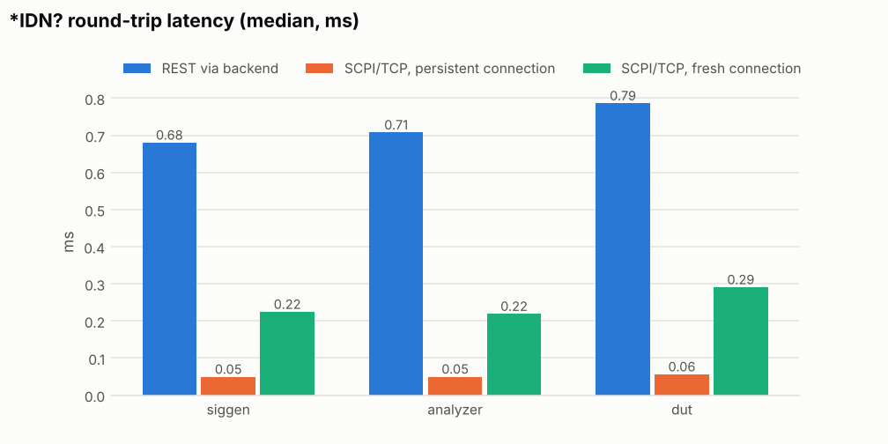
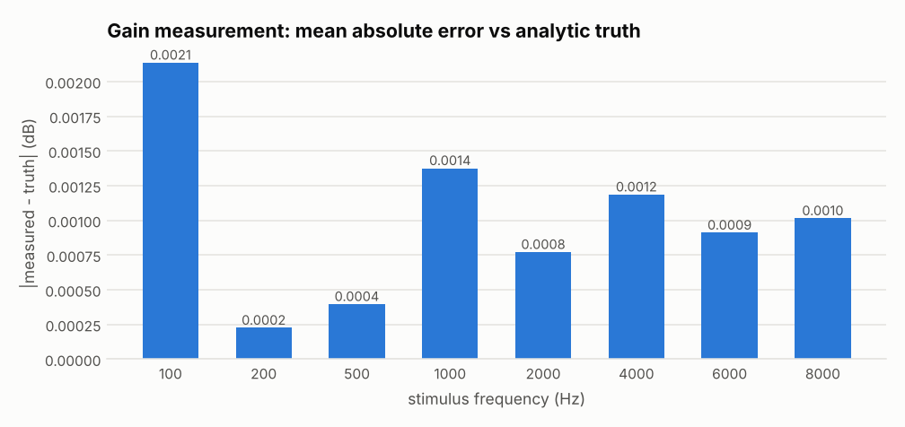
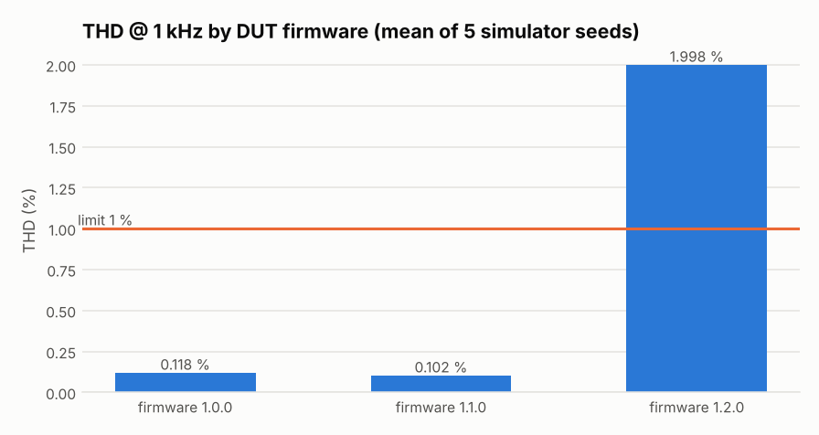
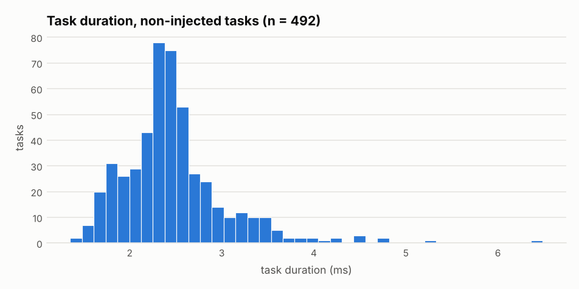

# MeasureFlow - Experiment Report

> **Scope.** All measurements come from the *simulated* instruments in `simulator/` (signal generator, audio analyzer, hearing-aid DUT) driven over real TCP/SCPI by the C++ backend. No real hardware was used and nothing here is a medical-device or regulatory validation.

Generated 2026-11-16T18:36:01Z - seed 12345 - Python 3.13.18 - Linux-6.18.44-fc-v470-x86_64-with-glibc2.39 (x86_64). Total experiment time 167.5 s. Raw data and per-experiment `config.json` / `log.txt` are in `results/experiments/`; re-run with `scripts/run_experiments.sh`.

## 1. Overview

| ID | Experiment | Harness | Duration |
|---|---|---|---|
| E01 | communication | completed | 1.7 s |
| E02 | accuracy | completed | 2.6 s |
| E03 | out_of_tolerance | completed | 20.5 s |
| E04 | timeout_retry | completed | 73.4 s |
| E05 | disconnect_recovery | completed | 7.2 s |
| E06 | invalid_response | completed | 9.8 s |
| E07 | firmware_regression | completed | 7.7 s |
| E08 | batch_500 | completed | 21.8 s |
| E09 | cancellation | completed | 21.2 s |
| E10 | end_to_end | completed | 1.5 s |

Defects flagged by the experiment harness: **0**.

**Outcome vocabulary** (used throughout, never merged): *expected measurement FAIL* = the DUT really is out of tolerance and the platform said FAIL; *expected injected fault* = a communication fault we injected ended in ERROR; *unexpected software error* = ERROR/FAIL nobody planned; *actual test success rate* = share of non-injected tasks that produced a valid measurement (PASS or FAIL, not ERROR). A FAIL is a correct measurement result, an ERROR means no valid measurement was obtained.

## 2. E01 - Communication

600 `*IDN?` queries through `/api/instruments/command` and 600 direct SCPI/TCP queries (success 100.0 % / 100.0 %; *IDN? field validation 100.0 %).

| Path | n | mean ms | p50 ms | p95 ms | p99 ms | max ms |
|---|---|---|---|---|---|---|
| REST (all instruments) | 600 | 0.758 | 0.713 | 1.052 | 1.284 | 1.651 |
| SCPI/TCP (all instruments) | 600 | 0.056 | 0.052 | 0.075 | 0.166 | 0.369 |

Error-queue behaviour checks: 15/15 passed. Reconnect cycles: 20 (success 100.0 %, connect p50 1.856 ms).

*Finding fixed during this experiment:* the first run measured ~44 ms per REST call; the cause was Nagle/delayed-ACK interaction in the HTTP server (header and body written separately). `set_tcp_nodelay(true)` removed it; all numbers above are from the fixed binary.

## 3. E02 - Measurement accuracy against analytic truth

Grid: profiles NORMAL, HIGHTHD, NOISY x frequencies [100, 200, 500, 1000, 2000, 4000, 6000, 8000] Hz x amplitudes [0.01, 0.05, 0.1] Vpk, firmware 1.0.0, 16384 samples at 48000 Hz. Truth = independent analytic model (`mfsim.truth`), not the simulator's own measurement code path. The guideline column is the tolerance given in `docs/INTERFACE.md`; "within guideline" is the share of grid points inside it.

| Quantity | n | bias (abs) | MAE (abs) | max |err| (abs) | MAE (rel %) | within guideline |
|---|---|---|---|---|---|---|
| rms_v | 72 | 0.00008 | 0.00012 | 0.00097 | 0.0378 | 100.0 % |
| gain_db | 72 | 0.00003 | 0.00100 | 0.01771 | 0.0054 | 100.0 % |
| thd_percent | 72 | 0.03638 | 0.03882 | 0.50399 | 1275.6797 | 73.6 % |
| snr_db | 72 | -0.02266 | 0.09932 | 0.28825 | 0.1812 | 100.0 % |
| noise_floor_dbv | 72 | 0.02269 | 0.09931 | 0.28878 | 0.1473 | 100.0 % |

The THD relative error is dominated by NOISY low-amplitude points whose analytic THD is close to zero (a tiny denominator); absolute error is the meaningful column for THD.

Repeatability (same instrument state, 30 fresh acquisitions at 1 kHz / 0.05 Vpk): rms_v std 9.55e-07, gain_db std 0.000031, thd_percent std 0.000450, snr_db std 0.133829, noise_floor_dbv std 0.133819.

Independent cross-check from the raw waveform (`MF:ACQ:WAV?`): numpy RMS vs SCPI RMS max relative difference 3.90e-08; sine-fit gain vs SCPI gain max |diff| 0.0127 dB.

**Limitation observed.** THD is within the INTERFACE.md guideline for only 73.6 % of grid points. Per profile (THD only):

| Profile | n | bias (%-pt) | max |err| (%-pt) | within guideline |
|---|---|---|---|---|
| NORMAL | 24 | 0.0006 | 0.0040 | 100.0 % |
| HIGHTHD | 24 | -4.52e-05 | 0.0047 | 100.0 % |
| NOISY | 24 | 0.1085 | 0.5040 | 20.8 % |

NOISY profile, THD error by stimulus amplitude (mean signed error, %-pt):

| Amplitude (Vpk) | n | mean error |
|---|---|---|
| 0.01 | 8 | 0.3198 |
| 0.05 | 8 | 0.0043 |
| 0.1 | 8 | 0.0016 |

The error shrinks monotonically as the stimulus amplitude grows, i.e. as SNR improves. This is consistent with output noise landing in the harmonic bins and being counted as distortion (the analytic truth is noise-free THD). It is a property of the estimator, not a numerical bug; it was not isolated further (no separate experiment removes the noise to confirm).

## 4. E03 - Out-of-tolerance detection

195 tasks from `full_pipeline` over DUT profiles x frequencies; expected status = analytic truth vs the sequence limits with an uncertainty budget. Tasks whose truth lies inside that budget of a limit are *borderline* (6) and are not judged, and CLIPPING SNR/noise-floor have no analytic truth and are likewise not judged.

| expected \ actual | PASS | FAIL | ERROR |
|---|---|---|---|
| PASS | 135 | 0 | 0 |
| FAIL | 0 | 54 | 0 |

Judged tasks 189: detection accuracy 100.0 %, false PASS 0, false FAIL 0, ERROR on clean runs 0. Actual PASS share 70.3 % vs expected 69.2 % (the two differ by the borderline tasks, which are included in the first but not judged).

| DUT profile | tasks | expected FAIL | actual FAIL | agreement (judged) |
|---|---|---|---|---|
| NORMAL | 39 | 0 | 0 | 100.0 % |
| LOWGAIN | 39 | 30 | 30 | 100.0 % |
| HIGHTHD | 39 | 3 | 3 | 100.0 % |
| NOISY | 39 | 6 | 6 | 100.0 % |
| CLIPPING | 39 | 21 | 19 | 100.0 % |

Limit proximity (limits set at truth gain +/- delta; 10 simulator seeds, 4 cases each):

| delta (dB) | n | accuracy | errors |
|---|---|---|---|
| 0.02 | 40 | 100.0 % | 0 |
| 0.05 | 40 | 100.0 % | 0 |
| 0.1 | 40 | 100.0 % | 0 |
| 0.5 | 40 | 100.0 % | 0 |

Measured gain minus truth: bias -0.000006 dB, max |err| 0.000107 dB (n=10); this is why deltas down to 0.02 dB are resolved.

## 5. E04 - Timeout and retry

84 cases: a number *n* of consecutive timeouts is injected on one measurement command while the task retry count *t* and the SCPI client retry count *r* are varied. Model under test: the command recovers iff n < (1 + t)(1 + r). Status prediction accuracy 100.0 % (status, error code and attempt count: 100.0 %); hangs 0; unexpected FAIL 0.

| Group | n | result | time p50 ms | time p95 ms | time max ms |
|---|---|---|---|---|---|
| recovered | 48 | PASS rate 100.0 %; max value error 0.000040 dB | 615.2 | 2015.4 | 2522.1 |
| unrecoverable | 24 | ERROR rate 100.0 %; code COMM_TIMEOUT 100.0 % | 967.6 | 2576.1 | 2694.2 |

Boundary search (largest n that still recovers):

| config | model capacity | observed last recovered n | predicted | first failing n |
|---|---|---|---|---|
| r=0,t=0 | 1 | 0 | 0 | 1 |
| r=0,t=1 | 2 | 1 | 1 | 2 |
| r=0,t=2 | 3 | 2 | 2 | 3 |
| r=0,t=3 | 4 | 3 | 3 | 4 |
| r=1,t=0 | 2 | 1 | 1 | 2 |
| r=1,t=1 | 4 | 3 | 3 | 4 |
| r=1,t=2 | 6 | 5 | 5 | 6 |
| r=1,t=3 | 8 | 7 | 7 | 8 |
| r=2,t=0 | 3 | 2 | 2 | 3 |
| r=2,t=1 | 6 | 5 | 5 | 6 |
| r=2,t=2 | 9 | 8 | 8 | 9 |
| r=2,t=3 | 12 | 11 | 11 | 12 |

The analyzer timeout was set to 150 ms in this experiment, so every failed attempt costs at least that much; the times above scale with the number of failed attempts and say nothing about production timeouts.

## 6. E05 - Disconnect and recovery

| Scenario | n | result | wall time p50 ms | max ms |
|---|---|---|---|---|
| transient disconnect | 15 | recovered and PASS 100.0 % | 109.3 | 214.4 |
| persistent disconnect | 5 | ERROR 100.0 % (COMM_DISCONNECTED) | 524.5 | 527.6 |

Unexpected FAIL tasks: 0. Instrument process killed mid-run: run ended `ERROR` with COMM_DISCONNECTED; backend health stayed HTTP 200 (status `degraded`); after restarting the simulator the platform recovered in 819 ms and the next run was PASS with 3 instruments connected. Overall recovery rate 100.0 %.

## 7. E06 - Invalid responses

50 injected malformed responses (garbage, fragmented, NaN, Inf, oversize ...): error-code mapping accuracy 100.0 %; any FAIL status 0; backend healthy afterwards 100.0 %; clean run after the fault PASS 100.0 %.

| Injection | n | mapping accuracy | error codes seen | statuses seen |
|---|---|---|---|---|
| garbage | 5 | 100.0 % | COMM_INVALID_RESPONSE | ERROR |
| nan | 5 | 100.0 % | MEASUREMENT_NAN | ERROR |
| inf | 5 | 100.0 % | MEASUREMENT_INF | ERROR |
| oversize | 5 | 100.0 % | COMM_RESPONSE_TOO_LARGE | ERROR |
| fragment | 5 | 100.0 % | None | PASS |
| empty_line | 5 | 100.0 % | COMM_INVALID_RESPONSE | ERROR |
| truncated | 5 | 100.0 % | COMM_TIMEOUT | ERROR |
| dut_nan_samples | 5 | 100.0 % | MEASUREMENT_NAN | ERROR |
| dut_inf_samples | 5 | 100.0 % | MEASUREMENT_NAN | ERROR |
| garbage_transient_default_retries | 5 | 100.0 % | None | PASS |

## 8. E07 - Firmware regression detection

`full_pipeline` on a NORMAL DUT, firmware 1.0.0 / 1.1.0 / 1.2.0, 3 firmware x 5 simulator seeds (15 runs, 195 tasks).

| Firmware | tasks | PASS | FAIL | ERROR | THD mean % | THD std | THD delta vs 1.0.0 (%-pt) |
|---|---|---|---|---|---|---|---|
| 1.0.0 | 65 | 65 | 0 | 0 | 0.1180 | 0.00019 | baseline |
| 1.1.0 | 65 | 65 | 0 | 0 | 0.1016 | 0.00019 | -0.0164 |
| 1.2.0 | 65 | 60 | 5 | 0 | 1.9980 | 0.00063 | 1.8800 |

Verdict accuracy vs analytic expectation 100.0 %; firmware 1.2.0 THD FAIL rate 100.0 %; other tasks failing on that firmware: none; false alarms on 1.1.0 / 1.0.0: 0 / 0. THD 1.2.0 / 1.0.0 = 16.9x. Mean change per quantity relative to 1.0.0 (INTERFACE.md describes 1.1.0 as a maintenance release with slightly lower noise and less 2nd harmonic, and 1.2.0 as the regression build):

| Quantity | 1.1.0 - 1.0.0 | 1.2.0 - 1.0.0 |
|---|---|---|
| rms | -0.0000 V | +0.0014 V |
| gain | +0.0000 dB | +0.0324 dB |
| thd | -0.0164 % | +1.8800 % |
| snr | +1.0000 dB | -4.9675 dB |
| noise_floor | -1.0000 dBV | +5.0000 dBV |

## 9. E08 - Batch of 500 test cases

Fixed-seed plan of 161 runs (full_pipeline = 13 tasks, frequency_sweep = 8, single-measurement sequences = 1) covering random DUT profile, firmware, stimulus; about 6 % of the single-task runs carry an injected communication fault. One *case* = one task. Planned 500, executed 500, not executed 0.

| Outcome class | tasks |
|---|---|
| borderline | 8 |
| expected_injected_fault | 8 |
| expected_measurement_fail | 99 |
| pass | 385 |

- Expected-status accuracy on judged tasks: **100.0 %** (8 borderline tasks not judged).
- Actual test success rate (non-injected tasks with a valid measurement): **100.0 %**.
- Injected-fault tasks: 8, all expected to end in ERROR.
- Unexpected software errors: **0** (task-level 0, run-level 0).
- Backend alive at end: True. Throughput 24.0 tasks/s over 20.8 s wall time.

Task duration (non-injected): p50 2.39 ms, p95 3.46 ms, max 6.49 ms. Backend RSS 6280 kB after warm-up -> 24288 kB at the end; file descriptors 9 -> 9, threads 18 -> 18. RSS grew during the batch; the cause was not analysed (run history and log buffers are plausible candidates) and no longer soak test or leak check was done, so the growth is reported, not explained.

*Harness bug found and fixed here:* in an earlier run of this experiment 22 runs ended ERROR with zero tasks and were silently dropped from the per-task classification (429/500 cases executed). Cause: a *persistent* injected timeout fault left its remaining count in the simulator, so the **next** run's `*IDN?` timed out. The backend reported it correctly (`COMM_TIMEOUT` in `init`). The harness now clears the simulator state after every fault run and counts any run-level ERROR without an injected fault as an unexpected software error.

## 10. E09 - Cancellation

30 trials (cancel at random delays during `full_pipeline` / `frequency_sweep`): 20 cancellations took effect, 10 runs had already finished.

| Check (effective cancellations) | rate |
|---|---|
| final status CANCELLED | 100.0 % |
| cleanup ran | 100.0 % |
| generator output OFF afterwards | 100.0 % |
| instrument leases released | 100.0 % |
| next run PASS | 100.0 % |
| CANCELLED persisted | 100.0 % |

Cancel latency (request to terminal state): mean 37.7 ms, p50 38.4, p95 49.2, max 54.9 ms (n=20). Resources: RSS 6916 -> 16008 kB, threads delta 0, fd delta 0. Failures: none.

## 11. E10 - End-to-end pipeline

13/13 checks passed (`all_passed = True`); full_pipeline wall time 54.8 ms.

| Check | ok | detail |
|---|---|---|
| health reachable | yes | degraded |
| environment report | yes | {'calibration': ['valid', 'valid']} |
| connect all instruments | yes | ['analyzer', 'dut', 'siggen'] |
| 7 sequences listed | yes | ['frequency_sweep', 'full_pipeline', 'gain_verification', 'noise_floor', 'rms_measurement', 'snr_measurement', 'thd_measurement'] |
| full_pipeline PASS | yes | {'status': 'PASS', 'counts': {'CANCELLED': 0, 'ERROR': 0, 'FAIL': 0, 'PASS': 13, 'PENDING': 0, 'RUNNING': 0}} |
| 13 tasks, sequential unique ids | yes | None |
| CSV report rows == tasks | yes | {'rows': 13} |
| HTML report contains run id | yes | {'bytes': 12328} |
| PDF report parses and contains run id | yes | {'pages': 2, 'bytes': 17195} |
| summary consistent with results | yes | {'summary_tasks': 13, 'results': 13} |
| history retained after backend restart | yes | {'runs': 1} |
| report still downloadable after restart | yes | None |
| post-restart run on faulty DUT is FAIL (not ERROR) | yes | {'status': 'FAIL', 'counts': {'CANCELLED': 0, 'ERROR': 0, 'FAIL': 10, 'PASS': 3, 'PENDING': 0, 'RUNNING': 0}} |

## 12. Limitations

- Everything runs against simulators on loopback. Latencies (sub-millisecond) say nothing about real LAN/GPIB/USB instruments.
- "Truth" is the simulator author's analytic model with an explicit uncertainty budget; agreement with it validates the numerics and the platform, not the physical model.
- Expected statuses for CLIPPING SNR / noise floor and for borderline tasks are not judged; they are counted separately, not as passes.
- Fault injection covers timeout, disconnect, garbage, fragmentation, NaN/Inf and oversize responses; it does not cover slow-loris style partial writes or OS-level network failures.
- Single machine, single backend instance, one seed (12345) for the reported figures; seed-to-seed variation is shown only where an experiment loops over simulator seeds (E02, E03, E07).
- No long-duration soak test; the RSS observations in E08/E09 are short-run snapshots.
- No real hardware and no medical-device / regulatory (IEC 60118, ANSI S3.22, etc.) validation was performed.
